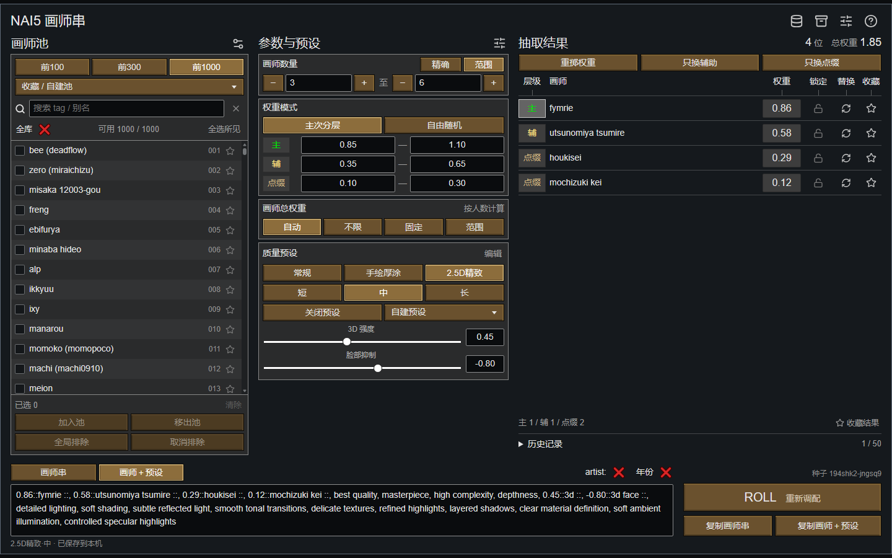
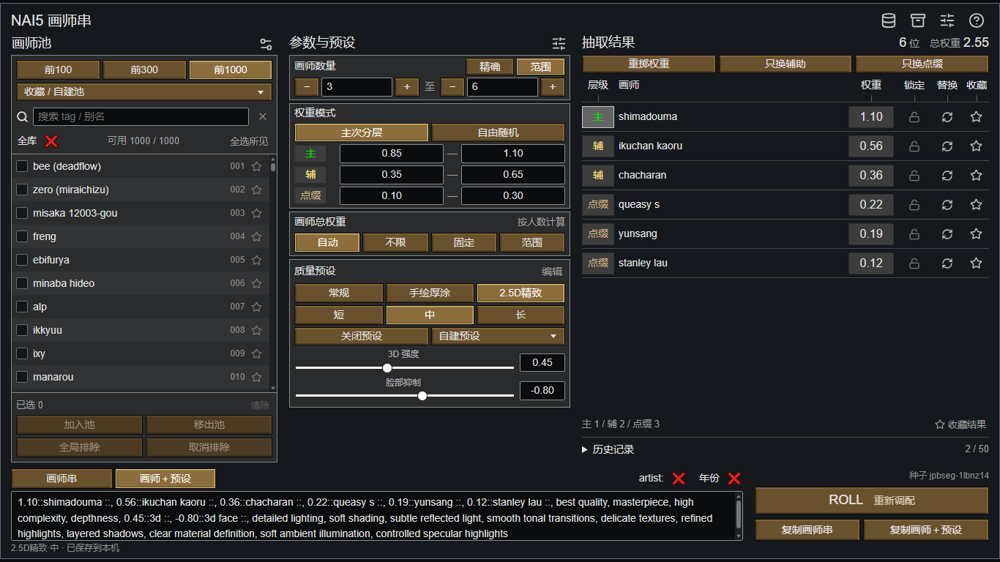
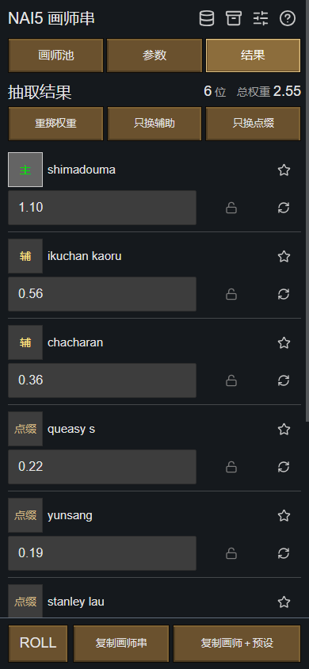

# 验证结果

验证日期：**2026-11-22**。正式入口：`http://127.0.0.1:4173/`。源码和内置快照与 `dist/` 对应；最终构建通过。

## 数据完整性

- 一轮连续采集：UTC **14:17:46.293–14:19:13.701**。
- 17 页、1020 条、1020 个唯一 tag，跨页重复 0；发布恰好 **1000** 条，源站顺序 **1–1000**。
- 所有页面显式包含 `s=favorites`；候选总数均为 3397；FAVS 单调不增；同票保留源站顺序。
- 992 条 `v5_gallery_sample`，8 条 `v5_gallery_listing`。这 8 条是 V5 榜单原有成员，其卡片缩略图来自其他模型；明细见 `data/SOURCE.md`，没有跨榜补数。
- `aliases`、`postCount`、`topScore` 未取得，1000 条均为 `null`，没有用 FAVS 代填。
- 浏览器卡片 HTML 重放结果与发布 JSON 完全一致；CSV 往返一致；更新失败及部分文件提交失败均保留上一版。

## 自动检查

| 检查 | 结果 | 记录 |
|---|---|---|
| `npm.cmd test` | **41 项通过**；含 2000 组种子 / 模式约束抽取 | `test-results.txt` |
| `python -m unittest discover -s tests -p 'test_*.py' -v` | **6 项通过** | `updater-test-results.txt` |
| `npm.cmd run build` | TypeScript 与 Vite 构建成功 | `build-results.txt` |
| Node 启动器 / 浏览器采集模块语法 | `node --check` 通过 | `scripts/serve.mjs`、`scripts/capture-browser.mjs` |

主 JS 包包含完整画师快照，为 632.47 kB（gzip 125.47 kB），CSS 为 23.28 kB（gzip 5.46 kB）；Vite 给出 500 kB 提示，构建成功。没有修改警告阈值隐藏提示。运行时不加载外站字体、图片或 API。

## 与目标验收项逐一对应

| 目标项 | 证据与结果 |
|---|---|
| 1：1000 个真实去重 V5 候选及来源 | 17 页原始卡片 HTML、`source.json`、Python 重放测试；恰好 1000 条 |
| 2：默认范围下的 5 人分层与 2.35 | 自动测试主1 / 辅2 / 点缀2、总和235整数单位、最多一项超过1.00；浏览器显示5位 / 2.35 |
| 3：主次5人固定3.60不可行 | 浏览器明确显示“可行区间 1.75–3.00”，ROLL 禁用；算法测试通过 |
| 4：自由5人固定3.60 | 浏览器实际复制 `1.09, 0.94, 0.55, 0.55, 0.47`，以整数百分位求和为360 |
| 5：3–6人固定3.20只有6人 | 浏览器显示“可抽数量：6”，抽取6人、总和3.20；算法测试通过 |
| 6：池不足、排除与重复 | 三人 JSON 池导入成功；要求4人时显示“当前可用3人”，ROLL禁用；搜索freng不改240人候选，显式排除变239、恢复后回240；别名冲突与重复ID测试通过 |
| 7：锁定与局部调整 | 算法覆盖锁人、锁重、缩人数冲突、范围冲突、设主、单替换、仅换辅助 / 点缀、仅重掷权重及手动改权重；浏览器锁重1.09后ROLL保留原身份与权重 |
| 8：可复现与持续满足约束 | 相同完整输入和种子测试；2000组抽取检查人数、层级、每项上下界、去重与总和 |
| 9：九套完整预设 | 默认输出与目标文件九段正文逐字一致；各风格短中长前缀逐层扩展；结构化替换而非追加 |
| 10：2.5D核心只出现一次 | 三档均检查一次正3d和一次负3d face，均位于正向组合输出；编辑校验重复和内部占位符 |
| 11：3D参数独立 | 浏览器修改为0.62 / -1.10并切长档，画师列表不变、画师总和仍2.35；自动测试覆盖 |
| 12：复制、刷新、历史和备份 | 浏览器实际剪贴板等于输出；刷新输出相同；改预设后恢复历史原文相同；JSON备份导出、三人池导入、完整备份恢复实测；数据版本变化后的历史 / 已移出画师保留测试通过 |
| 13：三种尺寸 | 正式构建通过无头 Edge CDP 设备视口在 1440×900、1366×768、390×844（三标签页）实测运行；均无横向溢出，1440×900 与 1366×768 中栏均无裁切，最终 PNG 已逐张目视核验 |
| 14：对照RimWorld样板修正 | 对照 `references/` 三张原始 PNG 像素级采样重建：深灰窗体 `#15191D`、外框 `#616C7A`、面板 `#2A2B2C/#323334` + `#878787` 描边、黄棕 2px 明暗浅浮雕按钮 `#6A512E`、绿勾/红叉开关、白线滑块、工作表竖向表头刻线与 `#00E600/#FFE680/#CCB380` 层级格、暗槽胶囊滚动条；已修正列表复选框对齐、1366×768 中栏完整展示与手机端 390px 触控与适配 |
| 15：必要测试和构建 | 41项前端逻辑 + 6项数据更新测试通过，构建通过 |
| 16：源码、数据、脚本、命令与截图 | 见根目录README、启动/停止CMD、src、data、scripts、tests与下方截图 |
| 17：实际限制 | 来源可能再次要求人工验证；实时HTTP更新会明确失败并保留旧版，可用正常验证后的浏览器采集再重放。实体手机和其他浏览器内核未单独实机测试 |

## 界面截图

最终截图直接通过无头 Edge CDP（`Emulation.setDeviceMetricsOverride`）在精确目标分辨率下对 `http://127.0.0.1:4173/` 正式构建采样并校验 DOM 布局指标，无后期缩放或重绘。

- 1440×900：文档宽 1440、高 900，无横向溢出；中栏全部 4 个参数分组（含 3D 强度与脸部抑制滑块）无滚动完整显示。
- 1366×768：文档宽 1366、高 768，无横向溢出；中栏全部 4 个参数分组与两个 3D 滑块同样完整显示（`scrollHeight == clientHeight == 557`），底部输出区与 ROLL / 复制按钮完整可见。
- 390×844：手机模拟视口 390×844，画师池 / 参数 / 结果三个标签页均无横向溢出（`scrollWidth == 390`）；触控按钮至少 44×44px，底部固定主操作区高 48px，ROLL 与复制按钮无截断。

## 启动与恢复

Windows PowerShell 5 启动脚本已采用 UTF-8 BOM；健康响应明确为 UTF-8，修正了中文路径误判。启动、重复启动复用同一进程、仅停止本项目进程、再启动均实测。正式服务的健康接口返回项目路径与PID，首页HTTP 200。临时Vite预览结束后，正式4173服务继续可用。
